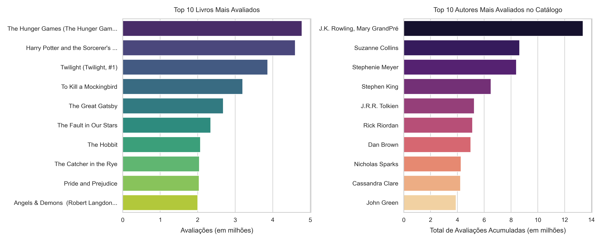
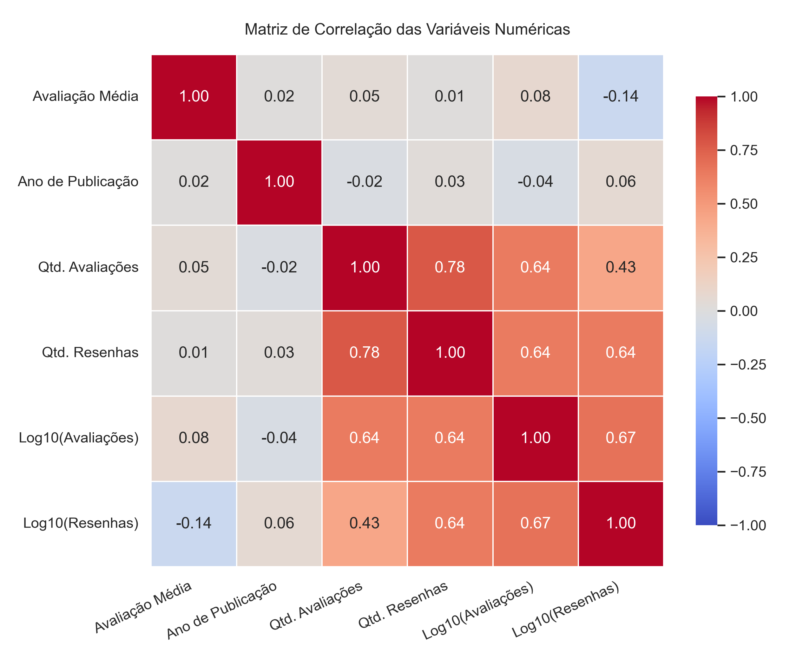

# Análise Exploratória e Estatística do Catálogo Goodreads 📚📊


Estudo de Análise Exploratória de Dados (EDA) e Inferência Estatística sobre **9.979 obras higienizadas** da plataforma Goodreads. O projeto investiga os fatores que influenciam a avaliação média e o engajamento dos leitores por meio de testes não paramétricos e análise multivariada.

---

## 📁 Estrutura do Repositório

```text
goodreads-eda-analysis/
├── raw_data/                           # Camada Raw (Dados brutos originais)
│   └── books.csv                       # Dataset original do Goodreads
├── processed_data/                     # Camada Curated (Dados higienizados)
│   └── books_clean.csv                 # Base limpa e tipada (9.979 registros)
├── notebooks/                          # Pipeline Analítico
│   └── eda_goodreads.ipynb             # Limpeza, EDA, testes estatísticos e gráficos
├── charts/                             # Visualizações Exportadas (300 DPI)
│   ├── 01_distribuicao_avaliacoes.png
│   ├── 02_avaliacao_periodo.png
│   ├── 03_avaliacao_idiomas.png
│   ├── 04_popularidade_vs_nota.png
│   ├── 05_mapa_calor_correlacao.png
│   └── 06_top_livros_autores.png
└── README.md
```

---

## 🎯 Principais Resultados

- **Popularidade vs. Nota Média ($\rho = 0,079$, $p = 2,53 \times 10^{-15}$):** Correlação monotônica praticamente nula. O alto volume de avaliações não eleva a nota média das obras.
- **Engajamento Textual vs. Nota Média ($\rho = -0,149$, $p = 7,80 \times 10^{-51}$):** Correlação negativa fraca e estatisticamente significativa — obras mais divisivas geram maior volume de resenhas escritas.
- **Viés de Sobrevivência Temporal ($H = 93,206$, $p = 4,48 \times 10^{-20}$):** Livros publicados antes de 1900 (*Clássicos*) apresentam medianas de avaliação superiores aos lançamentos contemporâneos.
- **Concentração do Catálogo:** Forte predominância de obras em língua inglesa ($H = 22,476$, $p = 1,61 \times 10^{-4}$ entre os Top 5 idiomas) e liderança de franquias Jovem-Adulto (*The Hunger Games*, *Harry Potter*, *Twilight*), com `J.K. Rowling, Mary GrandPré` somando mais de **13 milhões de avaliações**.

---

## 🔬 Metodologia e Validação Estatística

1. **Higienização (`raw_data` $\rightarrow$ `processed_data`):** Remoção de anos de publicação inválidos e valores ausentes críticos, além de transformação logarítmica ($\log_{10}$) para tratar a assimetria à direita (cauda longa) nas contagens de votos e resenhas.
2. **Testes Não Paramétricos ($\alpha = 0,05$):** Adotados devido à não normalidade das distribuições e presença de *outliers* naturais.

| Hipótese / Comparação | Teste | Estatística | Valor-$p$ | Significativo? |
| :--- | :--- | :---: | :---: | :---: |
| **Nota Média entre Períodos Históricos** | Kruskal-Wallis | $H = 93,206$ | $4,48 \times 10^{-20}$ | Sim |
| **Nota Média entre Top 5 Idiomas** | Kruskal-Wallis | $H = 22,476$ | $1,61 \times 10^{-4}$ | Sim |
| **Popularidade (Avaliações) vs. Nota** | Spearman | $\rho = 0,079$ | $2,53 \times 10^{-15}$ | Sim *(efeito nulo)* |
| **Engajamento (Resenhas) vs. Nota** | Spearman | $\rho = -0,149$ | $7,80 \times 10^{-51}$ | Sim *(negativa fraca)* |

---

## 📊 Visualizações

<p align="center">
  
</p>

<p align="center">
  
</p>

---

## 🚀 Como Executar

1. Clone o repositório e acesse a pasta do projeto:
   ```bash
   git clone [https://github.com/seu-usuario/goodreads-eda-analysis.git](https://github.com/seu-usuario/goodreads-eda-analysis.git)
   cd goodreads-eda-analysis
   ```
2. Instale as dependências:
   ```bash
   pip install pandas numpy scipy matplotlib seaborn jupyter
   ```
3. Execute o notebook em `notebooks/eda_goodreads.ipynb` para reproduzir a base higienizada (`processed_data/books_clean.csv`) e os gráficos em `charts/`.

---

## 📄 Produção Científica (Em andamento)

Os resultados estatísticos e visuais consolidados neste repositório servem de base empírica para a redação de um artigo científico em LaTeX (Overleaf), atualmente em fase de elaboração. Assim que concluído, o manuscrito final será disponibilizado diretamente neste repositório.
